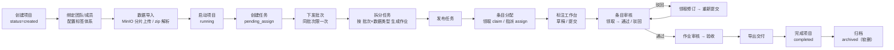
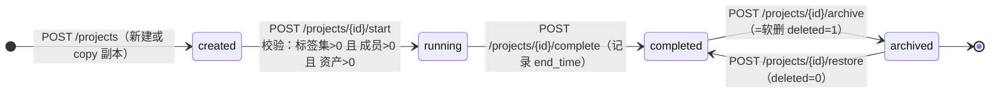
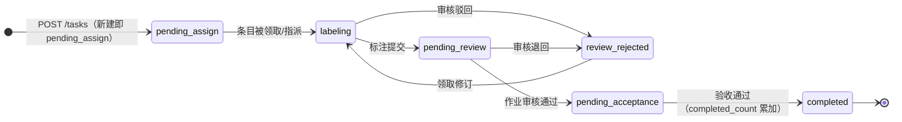
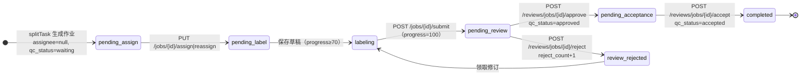
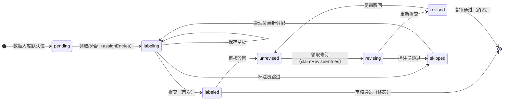
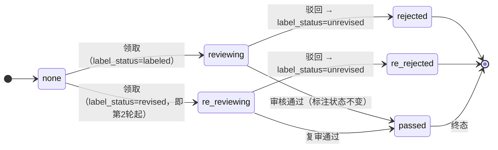
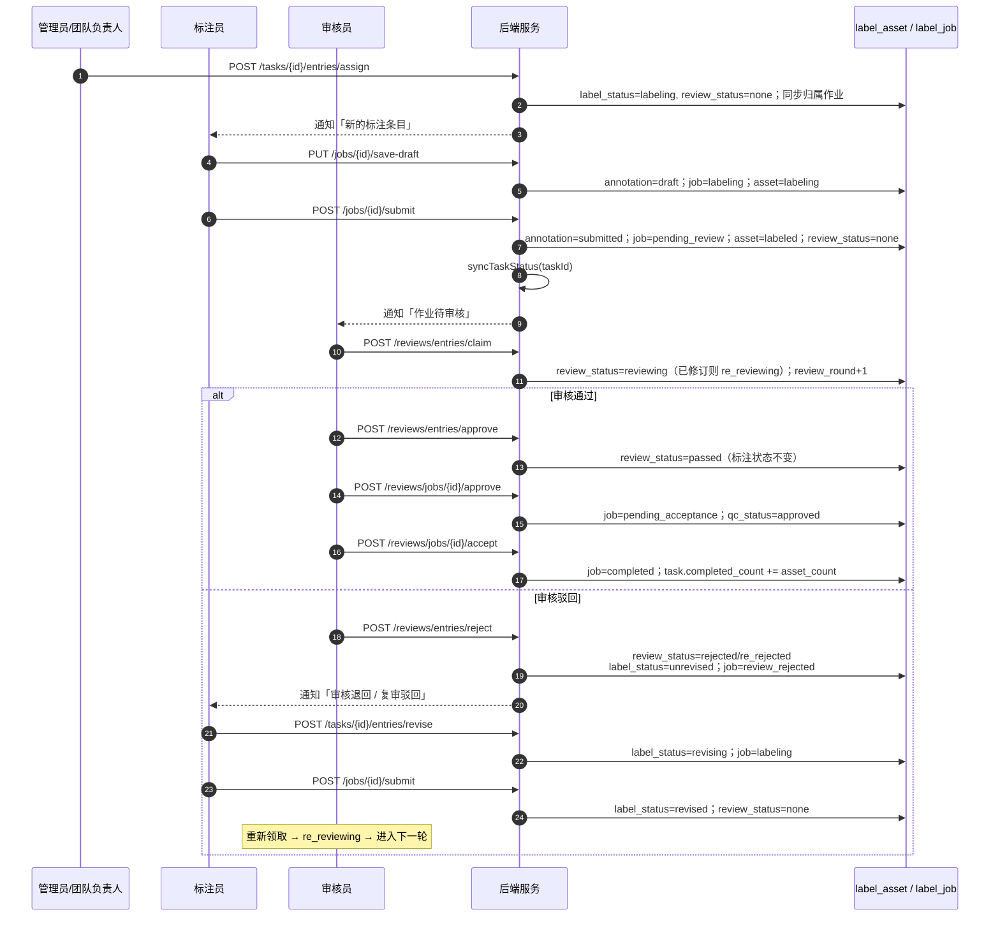
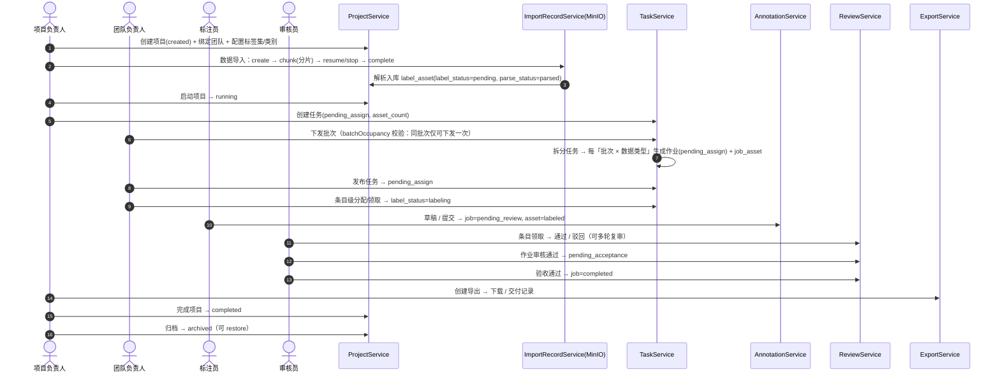

# 标注平台核心业务梳理（功能点 + 状态流转 + 时序图）

> 说明：本文档中的状态取值均与代码及 SQL 保持一致（`LabelEntryStatus` / `LabelReviewStatus` 常量、各 Mapper 的 `SET status=...` 语句、`script/sql/label_*_upgrade.sql` 字典定义）。
>
> 涉及模块：`ruoyi-modules/ruoyi-label`
> 主要实现类：`ProjectServiceImpl`、`TaskServiceImpl`、`AnnotationServiceImpl`、`ReviewServiceImpl`、`ExportService`
>
> 文档结构：
> - 一~五章：端到端流程、状态机、时序图、状态取值对照表
> - 六章：功能点梳理（功能地图 / 接口清单 / 角色权限 / 业务规则 / 数据模型）

---

# 一、端到端主线流程总览



---

# 二、五条核心状态机

## 1. 项目状态（`label_project.status`）



> 约束：`completed/archived` 的项目**不可再编辑**；仅 `completed` 可归档，仅 `archived` 可恢复。

## 2. 任务状态（`label_task.status`）— 聚合推导，非手动流转



**关键规则**：任务状态由 `syncTaskStatus(taskId)` 扫描其下全部作业状态**聚合**得出，取「最滞后」的一个（`TaskServiceImpl`）：

```
优先级（高→低）：pending_assign → labeling → review_rejected → pending_review → pending_acceptance → completed
```

> 即：只要还有一个作业是待分配，整个任务就显示「待分配」；全部作业完成才显示「已完成」。

## 3. 作业状态（`label_job.status` / `qc_status`）



> 兜底规则：作业资产数变动后重算，`assignee_id IS NULL ? pending_assign : pending_label`。

## 4. 条目标注状态机（`label_asset.label_status`，字典 `label_entry_status`）



> 提交时的分支（`updateAssetSubmitStatus`）：当前为 `unrevised/revising/revised/rejected` → 置 `revised`，否则置 `labeled`；同时把 `review_status` 重置为 `none`。

## 5. 条目审核状态机（`label_asset.review_status`，字典 `label_review_status`）



> 审核状态与标注状态**相互独立**：审核通过不改标注状态，只把审核状态置 `passed`；驳回才把标注状态拉回 `unrevised`。`review_round` 每次领取 +1，支持多轮复审。

---

# 三、核心时序图

## 1. 标注 ↔ 审核 ↔ 修订 闭环（最核心）



## 2. 端到端生产时序（项目 → 导入 → 任务 → 标注 → 审核 → 交付）



---

# 四、状态取值对照表

| 域 | 字段 | 取值 | 触发接口 |
|---|---|---|---|
| 项目 | `label_project.status` | `created / running / completed / archived` | `/projects`、`/start`、`/complete`、`/archive`、`/restore` |
| 任务 | `label_task.status` | `pending_assign / labeling / review_rejected / pending_review / pending_acceptance / completed` | `/split`、`/publish`、`/batches/{id}/assign` + `syncTaskStatus` 聚合 |
| 作业 | `label_job.status` | `pending_assign / pending_label / labeling / pending_review / review_rejected / pending_acceptance / completed` | `/jobs/{id}/assign`、`/save-draft`、`/submit`、`/reviews/jobs/{id}/approve\|reject\|accept` |
| 作业 | `label_job.qc_status` | `waiting / approved / accepted` | 审核通过 `approved`、验收通过 `accepted` |
| 标注记录 | `label_annotation.status` | `draft / submitted` | `/save-draft`、`/submit` |
| 条目标注 | `label_asset.label_status` | `pending / labeling / labeled / unrevised / revising / revised / skipped` | `/entries/assign\|skip\|revise`、`/jobs/{id}/submit` |
| 条目审核 | `label_asset.review_status` | `none / reviewing / rejected / re_reviewing / re_rejected / passed` | `/reviews/entries/claim\|approve\|reject` |
| 序列标注 | `label_annotation.status`（sequence_id 维度） | `draft / …` | `/sequences/{id}/annotation` |

---

# 五、核心结论

1. **项目** 是顶层容器（4 态：`created → running → completed → archived`），启动时强校验「标签集 / 成员 / 资产」三要素。
2. **任务状态是对其下作业状态的聚合投影**：`syncTaskStatus` 按「最滞后优先」规则推导，开发者不应手工直改任务状态。
3. **作业（job）** 承载标注进度与质检状态，是「任务 → 条目」之间的中间层。
4. **条目（asset）是双轨并行**的最小单位：
   - 标注轴 `label_status`：`pending → labeling → labeled → unrevised → revising → revised → skipped`
   - 审核轴 `review_status`：`none → reviewing/re_reviewing → passed / rejected / re_rejected`
   - 审核通过**只动审核轴**；驳回才把标注轴拉回 `unrevised`，形成「修订 → 重新提交 → 复审」闭环，支持多轮。
5. **批次约束**：同一批次只能下发一次（`batchOccupancy` 校验），保证数据不重复生产。

---

# 六、功能点梳理（全量）

> 覆盖模块：`ruoyi-modules/ruoyi-label`（14 个控制器分域 / 14 个 Service / 34 张业务表）
> 前端页面注册于 `sys_menu`（一级目录 9090「标注平台」+ 91xx 段），全部由 `getRouters()` 生成动态路由。

## 6.1 产品功能地图（菜单 ↔ 页面）

| 序号 | 功能模块 | 菜单/页面 | 前端组件 | URL | 侧边栏 |
|---|---|---|---|---|---|
| 9100 | 生产工作台 | 概览统计 / 待办 / 项目进度 / 工时 | `label/dashboard` | `/label-platform/dashboard` | 显示 |
| 9101 | 我的标注作业 | 标注员工作台（我的作业） | `label/task/work` | `/label-platform/work` | 显示 |
| 9102 | 项目管理 | 项目列表 | `label/project/list` | `/label-platform/projects` | 显示 |
| 9103 | 任务列表 | 任务管理 | `label/task/list` | `/label-platform/tasks` | 显示 |
| 9104 | 数据资产 | 资产管理 | `label/asset/list` | `/label-platform/assets` | 显示 |
| 9105 | 多传感器序列 | nuScenes 序列管理 | `label/sequence/list` | `/label-platform/sequences` | 显示 |
| 9106 | 质量审核 | 作业质检 / 验收 / 退回 | `label/review/list` | `/label-platform/reviews` | 显示 |
| 9107 | 团队协作 | 团队与工时 | `label/team/list` | `/label-platform/teams` | 显示 |
| 9108 | 数据导入 | 分片上传 / 续传 | `label/import/list` | `/label-platform/imports` | 显示 |
| 9109 | 数据导出 | 数据集导出与交付 | `label/export/list` | `/label-platform/exports` | 显示 |
| 9110 | 项目详情 | 项目概览 | `label/project/detail` | `/label-platform/project-detail` | 隐藏 |
| 9111 | 图像标注 | 图像标注工作台 | `label/annotate/image` | `/label-platform/image-annotate` | 隐藏 |
| 9112 | 点云标注 | 点云标注工作台 | `label/annotate/pointCloud` | `/label-platform/point-cloud-annotate` | 隐藏 |
| 9113 | 序列 3D 标注 | 多传感器序列 3D 标注 | `label/annotate/sequence` | `/label-platform/sequence-annotate` | 隐藏 |
| 9114 | 任务详情 | 任务条目视图（批次 + 条目） | `label/task/detail` | `/label-platform/task-detail` | 隐藏 |

## 6.2 后端接口功能清单（按域）

### ① 项目域 `ProjectController`（项目 / 成员 / 标签体系 / 资产 / 批次 / 上传）

| 功能点 | 接口 |
|---|---|
| 项目列表（关键字 / 状态 / 数据类型过滤） | `GET /projects` |
| 创建项目 | `POST /projects` |
| 项目详情 | `GET /projects/{id}` |
| 编辑项目 | `PUT /projects/{id}` |
| 删除项目（=归档） | `DELETE /projects/{id}` |
| 项目总览 | `GET /projects/{id}/overview` |
| 启动项目（校验标签集/成员/资产） | `POST /projects/{id}/start` |
| 完成项目 | `POST /projects/{id}/complete` |
| 归档项目 | `POST /projects/{id}/archive` |
| 恢复项目 | `POST /projects/{id}/restore` |
| 复制为副本项目 | `POST /projects/{id}/copy` |
| 项目成员 | `GET /projects/{id}/members` |
| 资产 zip 批量上传 | `POST /projects/{id}/assets/zip` |
| 类别集列表 | `GET /projects/{id}/class-sets` |
| 创建类别集 | `POST /projects/{id}/class-sets` |
| 更新 / 删除类别集 | `PUT /class-sets/{id}`、`DELETE /class-sets/{id}` |
| 类别列表 / 创建 | `GET /class-sets/{id}/classes`、`POST /class-sets/{id}/classes` |
| 更新 / 删除类别 | `PUT /classes/{id}`、`DELETE /classes/{id}` |
| 类别属性配置 | `PUT /classes/{id}/attributes` |
| 资产上传（JSON / 文件两种） | `POST /assets/upload` |
| 资产导入 | `POST /assets/import` |
| 项目资产分页 | `GET /projects/{id}/assets` |
| 资产详情 / 预览 | `GET /assets/{id}`、`GET /assets/{id}/preview` |
| 资产重新解析 | `POST /assets/{id}/retry` |
| 批次列表 / 详情 | `GET /asset-batches`、`GET /asset-batches/{id}` |
| 项目批次 / 创建批次 | `GET /projects/{id}/batches`、`POST /projects/{id}/batches` |
| 更新 / 删除批次（force 强删） | `PUT /asset-batches/{id}`、`DELETE /asset-batches/{id}` |
| 批次上传数据 / 上传详情 | `GET /asset-batches/{id}/uploads`、`GET /uploads/{id}` |
| 删除上传数据（force 强删） | `DELETE /uploads/{id}` |

### ② 任务域 `TaskController`（任务 / 批次下发 / 条目分配 / 作业）

| 功能点 | 接口 |
|---|---|
| 任务列表（关键字/状态/团队/收藏/scope） | `GET /tasks` |
| 创建任务 | `POST /tasks` |
| 任务详情 / 编辑 | `GET /tasks/{id}`、`PUT /tasks/{id}` |
| 批次占用查询（已下发批次禁用） | `GET /tasks/batches/occupancy` |
| 拆分任务（生成作业） | `POST /tasks/{id}/split` |
| 发布任务 | `POST /tasks/{id}/publish` |
| 任务作业列表 | `GET /tasks/{id}/jobs` |
| 任务批次（scope 过滤） | `GET /tasks/{id}/batches` |
| 批次下发到作业 | `POST /tasks/{id}/batches/{batchId}/assign` |
| 任务条目（items） | `GET /tasks/{id}/items` |
| 我负责的团队名 / 团队 ID | `GET /tasks/leader-teams`、`GET /tasks/leader-team-ids` |
| 任务条目分页（batch/tab/keyword/scope） | `GET /tasks/{id}/entries` |
| 条目状态统计（总览/待分配/已跳过/未修订） | `GET /tasks/{id}/entries/summary` |
| 条目分配 / 领取（claim 或 assign） | `POST /tasks/{id}/entries/assign` |
| 条目跳过 | `POST /tasks/{id}/entries/skip` |
| 领取修订 | `POST /tasks/{id}/entries/revise` |
| 条目定位所属作业 | `GET /tasks/{id}/entries/{assetId}/job` |
| 作业详情 | `GET /jobs/{id}` |
| 作业分配 / 重新分配 | `PUT /jobs/{id}/assign`、`PUT /jobs/{id}/reassign` |
| 作业状态更新 | `PUT /jobs/{id}/status` |
| 收藏 / 取消收藏任务 | `PUT /tasks/{id}/favorite`、`DELETE /tasks/{id}/favorite` |

### ③ 标注域 `AnnotationController`

| 功能点 | 接口 |
|---|---|
| 作业标注详情 | `GET /jobs/{id}/annotation` |
| 保存标注（新增 / 更新） | `POST`、`PUT /jobs/{id}/annotation` |
| 保存草稿 | `POST /jobs/{id}/save-draft` |
| 提交审核 | `POST /jobs/{id}/submit` |
| 资产标注 | `GET /assets/{id}/annotation` |
| 我的作业（按状态） | `GET /jobs/mine` |

### ④ 审核域 `ReviewController`

| 功能点 | 接口 |
|---|---|
| 待审作业列表 | `GET /reviews/jobs` |
| 作业详情 | `GET /reviews/jobs/{id}` |
| 作业审核通过 | `POST /reviews/jobs/{id}/approve` |
| 作业退回（附驳回原因） | `POST /reviews/jobs/{id}/reject` |
| 作业验收通过 | `POST /reviews/jobs/{id}/accept` |
| 作业审核记录 | `GET /reviews/jobs/{id}/records` |
| 条目审核列表（pending/reviewing/re_reviewing/passed/rejected/mine） | `GET /reviews/entries` |
| 条目领取审核 | `POST /reviews/entries/claim` |
| 条目审核通过（不动标注状态） | `POST /reviews/entries/approve` |
| 条目驳回（标注回到未修订） | `POST /reviews/entries/reject` |
| 条目审核历史 | `GET /reviews/entries/{assetId}/records` |

### ⑤ 导入域 `ImportRecordController`（前缀 `/import`，MinIO 分片）

| 功能点 | 接口 |
|---|---|
| 创建导入并初始化分片上传 | `POST /import/create` |
| 上传分片 | `POST /import/{id}/chunk` |
| 合并分片完成导入（异步入库） | `POST /import/{id}/complete` |
| 暂停导入（保留分片） | `POST /import/{id}/stop` |
| 续传导入（返回已传分片号） | `POST /import/{id}/resume` |
| 导入记录列表 / 详情 | `GET /import/list`、`GET /import/{id}` |
| 删除导入（清理 MinIO） | `DELETE /import/{id}` |

### ⑥ 多传感器序列域 `SequenceController`（nuScenes 阶段一）

| 功能点 | 接口 |
|---|---|
| 序列列表 / 详情 | `GET /sequences`、`GET /sequences/{id}` |
| 帧列表 | `GET /sequences/{id}/frames` |
| 帧传感器数据 | `GET /frames/{id}/sensor-data` |
| 传感器列表 | `GET /sensors` |
| 序列导入 | `POST /projects/{id}/sequences/import` |
| 序列标注查询 / 保存 | `GET`、`POST /sequences/{id}/annotation` |
| 标注错误列表 | `GET /sequences/{id}/errors` |
| 预检结果 / 执行预检 | `GET /sequences/{id}/prechecks`、`POST /sequences/{id}/precheck` |
| 批注列表 / 添加批注 | `GET`、`POST /sequences/{id}/comments` |
| 订正错误 / 订正批注 | `PUT /errors/{id}/correct`、`PUT /comments/{id}/correct` |

### ⑦ 团队域 `TeamController`

| 功能点 | 接口 |
|---|---|
| 团队列表 / 创建 / 详情 / 编辑 / 删除 | `GET`、`POST /teams`、`GET`、`PUT`、`DELETE /teams/{id}` |
| 团队成员查询 / 保存 | `GET`、`PUT /teams/{id}/members` |
| 团队工时统计 | `GET /teams/{id}/workload` |

### ⑧ 任务成员域 `TaskMemberController`

| 功能点 | 接口 |
|---|---|
| 成员候选（含是否已配置及任务内角色） | `GET /tasks/{id}/members/candidates` |
| 是否可配置成员 / 是否任务管理员 | `GET /tasks/{id}/members/configurable` |
| 当前用户是否可领取标注（二次校验兜底） | `GET /tasks/{id}/members/claimable` |
| 添加任务成员 | `POST /tasks/{id}/members` |
| 调整任务内角色（任务管理员 / 普通成员） | `PUT /tasks/{id}/members/role` |

### ⑨ 导出交付域 `ExportController`

| 功能点 | 接口 |
|---|---|
| 创建导出任务 | `POST /exports` |
| 导出任务列表 / 详情 | `GET /exports`、`GET /exports/{id}` |
| 取消导出 | `POST /exports/{id}/cancel` |
| 下载导出结果 | `GET /exports/{id}/download` |
| 交付记录 | `GET /delivery-records` |

### ⑩ 看板统计域 `DashboardController`

| 功能点 | 接口 |
|---|---|
| 概览统计 | `GET /dashboard/summary` |
| 待办事项 | `GET /dashboard/todos` |
| 项目进度 | `GET /dashboard/project-progress` |
| 工时统计 | `GET /dashboard/workload` |

### ⑪ 质检域 `QcController`

| 功能点 | 接口 |
|---|---|
| 质检报告列表 / 详情 | `GET /qc/reports`、`GET /qc/reports/{id}` |
| 质检规则列表 | `GET /qc/rules` |
| 创建 / 更新质检规则 | `POST /qc/rules`、`PUT /qc/rules/{id}` |
| 作业抽检 | `POST /qc/jobs/{id}/sample` |

### ⑫ 通知域 `NotificationController`

| 功能点 | 接口 |
|---|---|
| 通知列表 | `GET /notifications` |
| 未读数 | `GET /notifications/unread-count` |
| 标记已读 / 全部已读 | `PUT /notifications/{id}/read`、`PUT /notifications/read-all` |

### ⑬ 支撑域 `SupportController`

| 功能点 | 接口 |
|---|---|
| 用户候选下拉（按关键字 / 角色） | `GET /users` |
| 操作日志 | `GET /logs/operation` |
| 登录日志（占位） | `GET /logs/login` |

### ⑭ 文件访问网关 `FileAccessController`

| 功能点 | 接口 |
|---|---|
| MinIO 文件流式访问（保持 `/uploads/**` 契约） | `GET /uploads/**` |

## 6.3 角色与权限

| 角色 | role_key | 能力边界 |
|---|---|---|
| 超级管理员 | `admin` | 全部可见、全部可操作 |
| 项目负责人 | `project_leader` | 可被选为项目负责人；建项目时负责人只能从此角色选择 |
| 团队负责人 | `team_leader` | 可被选为团队负责人；可做条目级「分配他人」、查看本团队范围任务与工时 |
| 任务管理员 | 任务内角色（非全局 role_key） | 由任务成员升级而来，可配置任务成员 |
| 标注员 | — | 领取标注、保存草稿、提交、跳过、领取修订 |
| 审核员 | — | 领取条目审核、通过 / 驳回、作业审核与验收 |

关键权限规则：
- **数据权限**：非超管需在「系统管理-角色-菜单权限」勾选「标注平台」目录（写 `sys_role_menu`）后才可见页面。
- **团队范围**：`scope=myteam` 时，任务与条目仅在本团队接收范围内展示。
- **领取前置**：任务下发的团队成员须先被配置为「任务成员」才可领取标注（前端 `claimable` 判断 + 后端二次校验）。

## 6.4 关键业务规则清单

1. 项目未配置「标签集 / 成员 / 资产」时不允许启动。
2. `completed` 项目不可编辑；仅 `completed` 可归档；仅 `archived` 可恢复。
3. 任务状态由作业状态**聚合推导**（`syncTaskStatus`，最滞后优先），不可手工直改。
4. 同一批次只能下发一次（`label_task_batch` 唯一约束 + `batchOccupancy` 校验）。
5. 作业拆分维度 = 「批次 × 数据类型」，生成 `label_job` 与 `label_job_asset` 关联。
6. 条目标注与审核**双轨独立**：审核通过不动标注状态；驳回才把标注状态拉回 `unrevised`。
7. 提交分支：当前为 `unrevised/revising/revised/rejected` → 置 `revised`，否则置 `labeled`；同时 `review_status` 重置为 `none`。
8. 审核轮次 `review_round` 每次领取 +1，支持多轮复审（`reviewing` / `re_reviewing` 交替）。
9. 作业质检状态 `qc_status`：审核通过 `approved`、验收通过 `accepted`，默认 `waiting`。
10. 任务完成时把作业资产数累加进 `task.completed_count`，用于进度与看板统计。
11. 文件统一走 MinIO，对外 URL 契约恒为 `/uploads/**`，前端无需感知存储变更。
12. 导入采用 MinIO 分片上传，支持暂停 / 续传 / 断点恢复，`complete` 后异步解析入库。

## 6.5 数据模型概览（34 张业务表）

| 分域 | 表 |
|---|---|
| 项目 / 团队 | `label_project`、`label_project_member`、`label_project_team`、`label_team`、`label_team_member` |
| 标签体系 | `label_class_set`、`label_class`、`label_class_attribute` |
| 资产 / 批次 | `label_asset`、`label_asset_batch`、`label_upload` |
| 任务 / 作业 | `label_task`、`label_task_team`、`label_task_batch`、`label_task_member`、`label_task_favorite`、`label_job`、`label_job_asset` |
| 标注 | `label_annotation`、`label_annotation_object` |
| 审核 | `label_review_record` |
| 质检 | `label_qc_rule`、`label_qc_report` |
| 导出 / 交付 | `label_export_job`、`label_delivery_record` |
| 多传感器序列 | `label_sensor`、`label_calibration`、`label_ego_pose`、`label_sequence`、`label_frame`、`label_sensor_data`、`label_instance` |
| 序列质控 | `label_annotation_error`、`label_precheck`、`label_comment` |
| 导入记录 | `label_import_record`、`label_import_part` |
